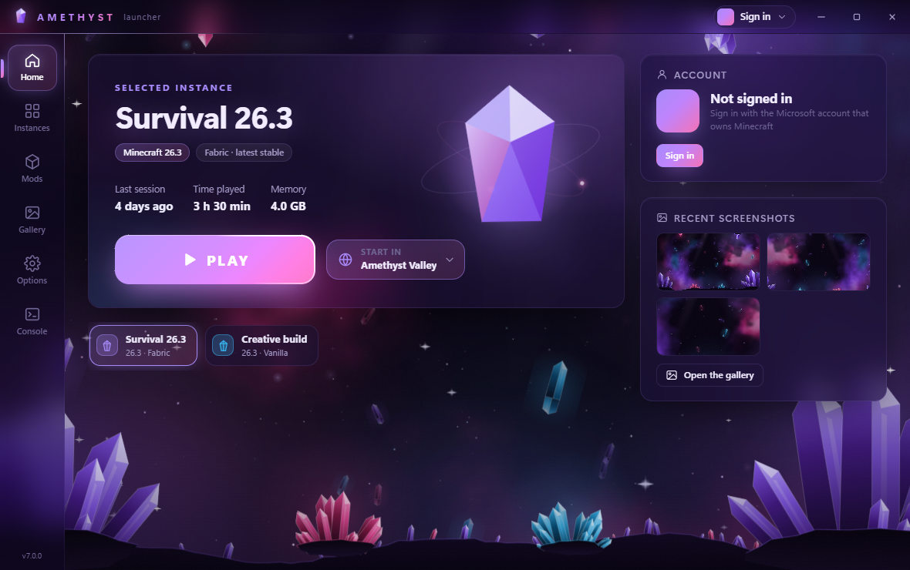
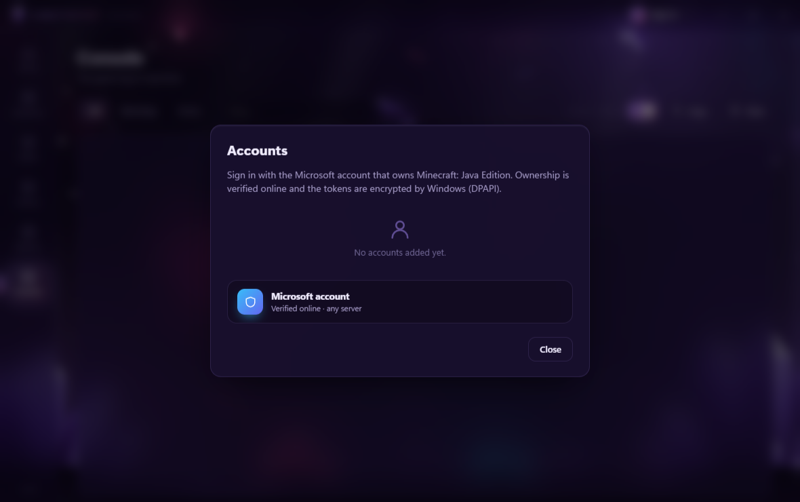

 AmethystLauncher

A lightweight Minecraft: Java Edition launcher built as a hobby project.

 Features
- Official Microsoft account sign-in (OAuth 2.0 with PKCE → Xbox Live → Minecraft Services)
- Verifies game ownership online
- Downloads and launches official game files from Mojang
- Clean purple UI

 Notes
- Requires a legitimate copy of Minecraft: Java Edition
- Does not bypass any authentication, license checks or security features
- Not affiliated with Mojang or Microsoft


## More features
- Microsoft accounts only: the game starts only with an account that owns Minecraft: Java Edition
- Separate instances, each with its own Minecraft version, memory and Java settings
- Fabric mods from Modrinth, with update checks
- "Start in": launch straight into a singleplayer world or a server
- Screenshot gallery
- English and Romanian




## How sign-in works
1. Microsoft sign-in in a separate window (OAuth 2.0 authorization code with PKCE, public client, no client secret)
2. Xbox Live and XSTS tokens
3. Minecraft Services login, then a check that the account owns the game
4. The tokens are stored encrypted with Windows DPAPI and are only sent to Microsoft and Minecraft services

The Azure Application (client) ID is set in *Options → Accounts*.

## Building
Requirements: Node.js 24.

```bash
npm install
npm test
npm start
```

`npm run dist` builds the Windows version in `dist/`.

